<div align="center">



# 🚀 Awesome Infrastructure &amp; Application Monitoring

### Curated Directory of Enterprise Observability Platforms &amp; Open-Source Telemetry Ecosystems

<p align="center">
  <a href="https://github.com/ishandutta2007/Awesome-Awesome-Awesome"></a><a href="https://discord.gg/jc4xtF58Ve"></a>
  <a href="https://github.com/ishandutta2007/Awesome-Infrastructure-Application-Monitoring/stargazers"></a>
  <a href="https://github.com/ishandutta2007/Awesome-Infrastructure-Application-Monitoring/network/members"></a>
  <a href="https://github.com/ishandutta2007/Awesome-Infrastructure-Application-Monitoring/pulls"></a>
  <a href="https://github.com/ishandutta2007/Awesome-Infrastructure-Application-Monitoring/blob/main/LICENSE"></a>
  <a href="https://github.com/ishandutta2007"></a>
</p>

<p align="center">
  <strong>A comprehensive, production-grade, SEO-optimized compendium of SaaS full-stack observability suites, APM engines, Kubernetes telemetry collectors, and sovereign open-source monitoring pipelines.</strong>
</p>

---

</div>

## 📌 Executive Summary &amp; Architectural Overview

Modern cloud-native, microservices, and hybrid computing architectures require unified **Full-Stack Observability**—synthesizing high-frequency **metrics (PromQL/Mimir)**, distributed **traces (OTel/Jaeger/Tempo)**, structured **logs (Loki/Elasticsearch)**, continuous **profiling (Pyroscope)**, and kernel-level **eBPF telemetry (Coroot/BCC/Tetragon)**.

Selecting the optimal observability and monitoring stack directly optimizes **Mean Time to Detection (MTTD)**, accelerates **Mean Time to Resolution (MTTR)**, reduces cloud telemetry egress costs, and drives automated root-cause analysis (AIOps/RCA).

### 🔍 Core Telemetry Domains:
- 🏢 **Enterprise SaaS Observability Platforms**: Fully managed multi-tenant suites providing turn-key collectors, out-of-the-box dashboards, machine-learning anomaly detection, and SLA correlation.
- 🔓 **Sovereign Open-Source Monitoring Systems**: Self-hosted, vendor-agnostic, and CNCF-graduated tools enabling complete telemetry sovereignty without data lock-in.

---

## 📑 Table of Contents

- [📊 Sector Overview &amp; Market Dynamics](#-sector-overview--market-dynamics)
- [🏢 SaaS &amp; Hosted Platforms](#-saas--hosted-platforms)
- [🔓 Open-Source GitHub Projects (Ranked by Stars)](#-open-source-github-projects-ranked-by-stars)
- [🏗️ Recommended Observability Reference Stacks](#️-recommended-observability-reference-stacks)
- [🤝 How to Contribute](#-how-to-contribute)
- [⚖️ Disclaimer &amp; Compliance](#️-disclaimer--compliance)
- [📈 Star History](#-star-history)
- [💖 Support &amp; Sponsorship](#-support--sponsorship)

---

## 📊 Sector Overview &amp; Market Dynamics

The global **Infrastructure &amp; Application Performance Monitoring (Observability)** sector is valued at **$18.5 Billion to $22.4 Billion in 2024–2026** and is projected to expand to over **$42.8 Billion by 2032**, demonstrating a steady compound annual growth rate (**CAGR of 11.8% to 13.4%**), propelled by multi-cloud complexity, Kubernetes container orchestration, microservices distribution, and high-density AI/ML compute workloads.

Market dynamics reflect a **moderately fragmented sector with concentrated oligopolistic power at the enterprise tier**: mega-cap tech conglomerates and dedicated leaders (Cisco/Splunk/AppDynamics, ServiceNow, Datadog, Dynatrace) command high-revenue enterprise contracts, while a hyper-vibrant and battle-tested **open-source ecosystem** (spearheaded by Prometheus, OpenTelemetry, Grafana, SigNoz, and Zabbix) prevents absolute winner-take-all capture, empowering engineering organizations to architect hybrid, sovereign, and cost-efficient monitoring pipelines.

---

## 🏢 SaaS &amp; Hosted Platforms

The table below catalogs premier commercial SaaS observability and monitoring solutions, sorted in **descending order by company size, market valuation, or annual recurring revenue (ARR)**.

| 🏢 Platform | 💰 Company Size / Valuation / Revenue | 🏷️ Pricing (Starting Tier) | 🎁 Free Tier / Trial Limit | ⚡ Key Capabilities &amp; Architectural Focus |
|:---|:---|:---|:---|:---|
| **[Cisco AppDynamics](https://www.appdynamics.com/)** | **~$235 Billion** *(Market Cap, NASDAQ: CSCO)* | **$6.00 / vCPU / month** *(Infrastructure Edition, billed annually)*; **$33.00 / vCPU / month** *(Premium APM)*; **$50.00 / vCPU / month** *(Enterprise)* | **15-day full-featured free trial**; includes complete APM, transaction mapping, and infrastructure monitoring (no credit card required) | Deep business transaction tracking, automated application topology mapping, Cognition Engine for AI-driven anomaly detection and RCA, and Business iQ correlation. |
| **[ServiceNow Monitoring](https://www.servicenow.com/)** | **~$165 Billion** *(Market Cap, NYSE: NOW)* | **~$46.00 / node / month** *(ITOM Health &amp; Event Management, contracted annually; ~$10k/yr starting commit)* | **Free Personal Developer Instance (PDI)** renewed every 10 days of active usage with full platform access; **30-day enterprise evaluation trial** | Service Observability on the Now Platform; cross-ingests Splunk logs, Zabbix/SolarWinds network telemetry; Now Assist GenAI incident analysis and synthetic monitoring. |
| **[Datadog](https://www.datadoghq.com/)** | **~$40 Billion** *(Market Cap, NASDAQ: DDOG)* | **$15.00 / host / month** *(Pro Plan, billed annually)* or **$18.00 / host / month** *(On-Demand)*; APM starting at **$31.00 / host / month** | **Free forever tier for up to 5 hosts** with 1-day metric retention and core dashboards; **14-day unrestricted full-enterprise free trial** (no credit card required) | Unified SaaS platform spanning infrastructure, APM, log management, network performance, continuous profiling, and Watchdog AI-powered anomaly detection. |
| **[Dynatrace](https://www.dynatrace.com/)** | **~$15 Billion** *(Market Cap, NYSE: DT)* | **$0.04 / hour per 8GB host** (~**$29.20 / host / month**) for Infrastructure Monitoring; **$0.08 / hour per 8GB host** (~**$58.40 / host / month**) for Full-Stack APM | **15-day full-featured free trial** with up to 5 full-stack OneAgent deployments; permanent **Dynatrace Playground** pre-loaded with simulated enterprise data | Autonomous OneAgent discovery, Grail data lakehouse, Davis AI deterministic causation engine for automatic root-cause analysis, and topological service mapping. |
| **[Site24x7](https://www.site24x7.com/)** | **~$7 Billion** *(Est. Valuation / Zoho Corp $1.4B+ ARR, Private)* | **$9.00 / month** *(Pro Plan, billed annually)* or **$10.00 / month** *(monthly)* covering 10 servers/websites and 1 APM application insight | **Free forever tier for up to 50 basic website/URL uptime checks** (10-min interval, email alerts); **30-day all-inclusive free trial** covering full server/APM capabilities | All-in-one DevOps monitoring suite covering cloud infrastructure (AWS/Azure/GCP), physical servers, synthetic transactions, network devices, and Zia AI anomaly detection. |
| **[New Relic](https://newrelic.com/)** | **$6.5 Billion** *(Acquisition Valuation by Francisco Partners &amp; TPG)* | **$49.00 / standard user / month** *(Standard Plan)* + **$0.35 / GB** for data ingestion beyond the monthly free allowance | **Free forever tier with 100 GB / month free data ingestion**, 1 full-platform user, unlimited basic users, and 30+ day retention (no credit card required) | Telemetry Data Platform with 300+ turn-key integrations, native OpenTelemetry ingestion, Applied Intelligence alert correlation, and full-stack distributed APM tracing. |
| **[Grafana Cloud](https://grafana.com/)** | **$6.0 Billion** *(Series D Valuation / $400M+ ARR, Grafana Labs)* | **$19.00 / month platform fee** *(Pro Tier)* + usage-based data scaling (**$0.50 / GB** logs/traces, **$0.11 / 1k metrics** past baseline) | **Free forever tier**: **10,000 active metric series**, **50 GB logs**, **50 GB traces**, **50 GB continuous profiles**, 3 user seats, and 14-day data retention | Managed open-observability ecosystem combining Grafana, Mimir (metrics), Loki (logs), Tempo (traces), and Pyroscope (profiling) with Adaptive Telemetry spend optimization. |
| **[SolarWinds Observability](https://www.solarwinds.com/)** | **$4.4 Billion** *(Enterprise Value / Acquired by Turn/River Capital)* | **$8.00 / node / month** *(Self-Hosted, billed annually)*; SaaS Application Observability starting at **$27.50 / service / month** | **30-day unrestricted enterprise free trial** with up to 10 GB/day log ingestion and APM; automatically transitions to limited Lite tier without access lockouts | Comprehensive hybrid IT and cloud-native observability, multi-source log aggregation with AIOps correlation, microservice topology discovery, and Kubernetes monitoring. |
| **[LogicMonitor](https://www.logicmonitor.com/)** | **$2.4 Billion** *(Valuation / $400M+ ARR, Vista Equity Partners)* | **$16.00 / Hybrid Unit (HU) / month** *(Essentials Plan, billed annually)*; **$27.00 / HU / month** *(Advanced Plan with early AI analytics)* | **14-day full-featured free trial** with up to 25 monitored hybrid resources, out-of-the-box dashboards, alerting, and sandbox environment | Hybrid observability platform (LM Envision) with 3,000+ pre-built integrations, Edwin AI agentic noise reduction, automated topological discovery, and cloud cost analytics. |
| **[Zabbix Enterprise](https://www.zabbix.com/)** | **~$60 Million** *(Est. Valuation / Zabbix SIA ~$20M ARR, Bootstrapped)* | **100% Free Core Software**; Commercial Enterprise Support contracts start at **€1,750 / year** (~**$1,900 / year**) for Bronze Support tier | **100% free and open-source forever** with unlimited hosts, metrics, items, triggers, and users under the GNU AGPL v3 license | Enterprise-grade monitoring powerhouse; Zabbix 8.0 LTS adds native OpenTelemetry APM ingestion, MCP server for AI agent integration, Complex Event Processing (CEP), and ClickHouse storage. |

---

## 🔓 Open-Source GitHub Projects (Ranked by Stars)

The following open-source solutions provide self-hosted, sovereign, and flexible infrastructure and application monitoring. Each entry includes its real-time **GitHub Stars_Count badge** linking directly to the project's stargazers page, sorted in **strict descending order of GitHub_Stars**.

### 1. 🟢 [Uptime Kuma](https://github.com/louislam/uptime-kuma) [](https://github.com/louislam/uptime-kuma/stargazers)
* **Primary Focus**: 🌐 Self-Hosted Uptime &amp; Service Availability Monitoring
* **Tech Stack &amp; License**: Node.js, Vue.js, SQLite | **MIT License**
* **Architectural Highlights**: Responsive self-hosted monitoring tool that provides multi-protocol uptime checks (HTTP/HTTPS, TCP, Ping, DNS, Docker container health), SSL certificate expiration tracking, public status pages, and instant alerting across 90+ notification services (Discord, Telegram, Slack, Webhooks).

### 2. ⚡ [Netdata](https://github.com/netdata/netdata) [](https://github.com/netdata/netdata/stargazers)
* **Primary Focus**: 📈 Real-Time, High-Fidelity Infrastructure &amp; OS Telemetry
* **Tech Stack &amp; License**: C, Go, Python | **GPL v3 License**
* **Architectural Highlights**: Delivers per-second metric granularity with minimal CPU and memory footprints. Auto-detects 800+ integrations (system metrics, hardware sensors, containers, web servers, databases) and provides unsupervised machine-learning anomaly detection out of the box.

### 3. 🔎 [Elasticsearch](https://github.com/elastic/elasticsearch) [](https://github.com/elastic/elasticsearch/stargazers)
* **Primary Focus**: 📜 Distributed Telemetry Storage, Search &amp; Enterprise Log Analytics
* **Tech Stack &amp; License**: Java | **Elastic License 2.0 / SSPL / Apache 2.0 dual**
* **Architectural Highlights**: Distributed, RESTful search and analytics engine underpinning the Elastic Observability ecosystem. Provides high-speed log ingestion, automated index lifecycle management (ILM), synthetics monitoring, and dense vector search for observability data.

### 4. 📊 [Grafana](https://github.com/grafana/grafana) [](https://github.com/grafana/grafana/stargazers)
* **Primary Focus**: 🖥️ Universal Telemetry Visualization &amp; Operational Dashboards
* **Tech Stack &amp; License**: TypeScript, Go | **AGPL v3 License**
* **Architectural Highlights**: The de facto industry standard for composable observability dashboards. Plugs seamlessly into Prometheus, Loki, Tempo, InfluxDB, Elasticsearch, ClickHouse, and dozens of third-party backends. Provides unified alert management, role-based access control, and dynamic query editors.

### 5. 🔥 [Prometheus](https://github.com/prometheus/prometheus) [](https://github.com/prometheus/prometheus/stargazers)
* **Primary Focus**: ⏱️ Cloud-Native Time-Series Metrics Collection &amp; Alerting
* **Tech Stack &amp; License**: Go | **Apache 2.0 License**
* **Architectural Highlights**: CNCF graduated project and the foundation of modern Kubernetes observability. Implements an efficient dimensional data model with key-value labels, the powerful PromQL query language, a pull-based scraping architecture, and Alertmanager routing.

### 6. 💻 [Glances](https://github.com/nicolargo/glances) [](https://github.com/nicolargo/glances/stargazers)
* **Primary Focus**: 🎛️ Cross-Platform System &amp; Container Terminal Monitoring
* **Tech Stack &amp; License**: Python | **LGPL v3 License**
* **Architectural Highlights**: Lightweight CLI and web-based monitoring tool that captures CPU, memory, load, processes, network I/O, disk partitions, GPU sensors, Docker containers, and AMPs (Application Monitoring Processes). Exposes a clean RESTful JSON API and web dashboard.

### 7. 🚀 [SigNoz](https://github.com/SigNoz/signoz) [](https://github.com/SigNoz/signoz/stargazers)
* **Primary Focus**: 🎯 OpenTelemetry-Native Full-Stack APM &amp; Observability (Datadog Alternative)
* **Tech Stack &amp; License**: Go, TypeScript, ClickHouse | **Apache 2.0 / BSL License**
* **Architectural Highlights**: Open-source APM alternative to Datadog and New Relic. Built natively on OpenTelemetry standards and powered by a blazing-fast ClickHouse columnar storage backend. Seamlessly correlates distributed traces, metrics, and structured logs in a single unified UI.

### 8. 📜 [Grafana Loki](https://github.com/grafana/loki) [](https://github.com/grafana/loki/stargazers)
* **Primary Focus**: 🗄️ Horizontally Scalable, Label-Indexed Log Aggregation
* **Tech Stack &amp; License**: Go | **AGPL v3 License**
* **Architectural Highlights**: Designed on the philosophy of Prometheus: indexes only metadata labels rather than full-text payloads. Dramatically lowers cloud storage costs by storing compressed log streams in object storage (AWS S3, GCS, MinIO) and provides LogQL for filtering and metric generation.

### 9. 🌌 [Apache SkyWalking](https://github.com/apache/skywalking) [](https://github.com/apache/skywalking/stargazers)
* **Primary Focus**: 🧭 Distributed APM, Service Mesh Telemetry &amp; Diagnostics
* **Tech Stack &amp; License**: Java | **Apache 2.0 License**
* **Architectural Highlights**: Comprehensive application performance monitor specifically designed for microservices, cloud-native, and container-based (Docker, Kubernetes, Mesos) architectures. Supports auto-instrumentation agents for Java, .NET, Node.js, Go, Python, and Envoy service mesh telemetry.

### 10. 🕵️ [Jaeger](https://github.com/jaegertracing/jaeger) [](https://github.com/jaegertracing/jaeger/stargazers)
* **Primary Focus**: 🔀 Distributed Tracing &amp; Microservice Transaction Profiling
* **Tech Stack &amp; License**: Go | **Apache 2.0 License**
* **Architectural Highlights**: CNCF graduated distributed tracing platform originally created by Uber. Monitors complex microservice transactions, pinpoints distributed latency bottlenecks, visualizes dependency DAGs, and supports OpenTelemetry instrumentation formats natively.

### 11. 🛡️ [BCC (BPF Compiler Collection)](https://github.com/iovisor/bcc) [](https://github.com/iovisor/bcc/stargazers)
* **Primary Focus**: 🧬 Kernel-Level eBPF Tracing, Performance &amp; Latency Analysis
* **Tech Stack &amp; License**: C, Python, Lua | **Apache 2.0 License**
* **Architectural Highlights**: Toolkit for creating efficient kernel tracing and manipulation programs using extended Berkeley Packet Filters (eBPF). Inspects disk I/O latency, memory allocation leaks, TCP socket lifecycle, and process run-queue latency with near-zero runtime overhead.

### 12. 📦 [cAdvisor](https://github.com/google/cadvisor) [](https://github.com/google/cadvisor/stargazers)
* **Primary Focus**: 🐳 Container Resource Usage &amp; Performance Telemetry
* **Tech Stack &amp; License**: Go | **Apache 2.0 License**
* **Architectural Highlights**: Developed by Google; analyzes and exposes resource usage and performance characteristics of running containers (CPU, memory, filesystem, network). Native integration within the Kubernetes Kubelet for node-level container metric aggregation.

### 13. 📉 [VictoriaMetrics](https://github.com/VictoriaMetrics/VictoriaMetrics) [](https://github.com/VictoriaMetrics/VictoriaMetrics/stargazers)
* **Primary Focus**: 💾 High-Performance, Cost-Effective Prometheus Long-Term Storage
* **Tech Stack &amp; License**: Go | **Apache 2.0 License**
* **Architectural Highlights**: Ultra-fast, resource-efficient time-series database (TSDB) engineered as a drop-in replacement or remote storage engine for Prometheus. Delivers exceptional compression ratios, low RAM consumption, and sub-second query execution across high-cardinality metric sets.

### 14. 🔌 [Telegraf](https://github.com/influxdata/telegraf) [](https://github.com/influxdata/telegraf/stargazers)
* **Primary Focus**: 📥 Plugin-Driven Server Agent for Metric Collection &amp; Processing
* **Tech Stack &amp; License**: Go | **MIT License**
* **Architectural Highlights**: Part of the InfluxData ecosystem; an extensible agent featuring 300+ community-built input, processor, aggregator, and output plugins. Collects metrics from databases, message queues, IoT sensors, and OS internals, dispatching to any telemetry store.

### 15. 📍 [OpenZipkin](https://github.com/openzipkin/zipkin) [](https://github.com/openzipkin/zipkin/stargazers)
* **Primary Focus**: 🧵 Distributed Tracing System for Microservice Latency Diagnostics
* **Tech Stack &amp; License**: Java | **Apache 2.0 License**
* **Architectural Highlights**: Battle-tested distributed tracing system that helps gather timing data needed to troubleshoot latency problems in service architectures. Features Cassandra, Elasticsearch, and MySQL storage backends and native integration with Spring Cloud Sleuth and Brave.

### 16. 🪐 [Thanos](https://github.com/thanos-io/thanos) [](https://github.com/thanos-io/thanos/stargazers)
* **Primary Focus**: 🌌 Highly Available Metric System with Unlimited Storage for Prometheus
* **Tech Stack &amp; License**: Go | **Apache 2.0 License**
* **Architectural Highlights**: CNCF graduated project providing seamless global metric view, high availability, and historical data backup to cloud object storage (S3, GCS, Azure Blob) across multi-cluster Prometheus deployments without downtime.

### 17. 🌊 [Fluentd](https://github.com/fluent/fluentd) [](https://github.com/fluent/fluentd/stargazers)
* **Primary Focus**: 📄 Unified Logging Layer for Cross-Platform Log Collection
* **Tech Stack &amp; License**: Ruby, C | **Apache 2.0 License**
* **Architectural Highlights**: CNCF graduated unified data collector that unifies data collection and consumption for better use and understanding of data. Offers 500+ plugins connecting to multiple log destinations and reliable buffering mechanisms.

### 18. 🔥 [Grafana Pyroscope](https://github.com/grafana/pyroscope) [](https://github.com/grafana/pyroscope/stargazers)
* **Primary Focus**: 🔬 Continuous Profiling Platform for CPU &amp; Memory Allocation
* **Tech Stack &amp; License**: Go | **AGPL v3 License**
* **Architectural Highlights**: Continuous profiling platform designed to monitor application performance at the line-of-code level. Visualizes flame graphs, identifies CPU hotspots, detects memory leaks, and correlates profiling data directly with distributed traces.

### 19. ⚡ [Fluent Bit](https://github.com/fluent/fluent-bit) [](https://github.com/fluent/fluent-bit/stargazers)
* **Primary Focus**: 🪶 Super-Fast, Lightweight Telemetry Agent for Embedded &amp; Container Logs
* **Tech Stack &amp; License**: C | **Apache 2.0 License**
* **Architectural Highlights**: High-performance, multi-platform log, metric, and trace processor and forwarder. Extremely low memory footprint (~450KB), zero-dependency design, ideal for high-throughput Kubernetes DaemonSets and edge computing.

### 20. 🤖 [Coroot](https://github.com/coroot/coroot) [](https://github.com/coroot/coroot/stargazers)
* **Primary Focus**: 🩺 Zero-Code eBPF-Based APM &amp; Infrastructure Observability
* **Tech Stack &amp; License**: Go | **Apache 2.0 License**
* **Architectural Highlights**: Leverages Linux kernel eBPF probes to intercept inter-service network traffic, CPU profiling, and database calls without changing code or importing language agents. Automatically diagnoses service degradation and visualizes dynamic network topology maps.

### 21. 🌐 [OpenTelemetry Collector](https://github.com/open-telemetry/opentelemetry-collector) [](https://github.com/open-telemetry/opentelemetry-collector/stargazers)
* **Primary Focus**: 🔄 Vendor-Agnostic Telemetry Ingestion, Processing &amp; Export
* **Tech Stack &amp; License**: Go | **Apache 2.0 License**
* **Architectural Highlights**: The vendor-neutral telemetry proxy of the Cloud Native Computing Foundation (CNCF). Ingests metrics, traces, and logs across OTLP, Jaeger, Zipkin, and Prometheus formats; transforms and sanitizes telemetry; and fans out data to multiple backends simultaneously.

### 22. 🏢 [Zabbix](https://github.com/zabbix/zabbix) [](https://github.com/zabbix/zabbix/stargazers)
* **Primary Focus**: 📡 Enterprise-Scale Network, Server &amp; Distributed Monitoring
* **Tech Stack &amp; License**: C, PHP, Go | **AGPL v3 License**
* **Architectural Highlights**: Proven enterprise monitoring platform supporting agent-based and agentless monitoring (SNMP, IPMI, JMX, SSH). Zabbix 8.0 LTS introduces native OpenTelemetry trace ingestion for full APM, MCP server integration for AI assistants, and high-performance ClickHouse storage backends.

### 23. 🗃️ [Cortex](https://github.com/cortexproject/cortex) [](https://github.com/cortexproject/cortex/stargazers)
* **Primary Focus**: 📈 Horizontally Scalable, Multi-Tenant, Long-Term TSDB for Prometheus
* **Tech Stack &amp; License**: Go | **Apache 2.0 License**
* **Architectural Highlights**: CNCF graduated project delivering scalable multi-tenant metrics as a service. Provides a globally queryable PromQL interface backed by cheap object storage (S3/GCS) with built-in query caching and deduplication.

### 24. 🎯 [Grafana Tempo](https://github.com/grafana/tempo) [](https://github.com/grafana/tempo/stargazers)
* **Primary Focus**: 🧩 Massive-Scale Distributed Tracing Backend
* **Tech Stack &amp; License**: Go | **AGPL v3 License**
* **Architectural Highlights**: High-throughput distributed tracing backend requiring only object storage (S3/GCS/Azure Blob). Integrates with Jaeger, Zipkin, and OpenTelemetry, allowing engineers to query traces directly from Grafana without costly full-payload indexing.

### 25. 🔒 [Tetragon (Cilium)](https://github.com/cilium/tetragon) [](https://github.com/cilium/tetragon/stargazers)
* **Primary Focus**: 🛡️ eBPF-Based Real-Time Security Observability &amp; Runtime Enforcement
* **Tech Stack &amp; License**: Go, C | **Apache 2.0 License**
* **Architectural Highlights**: Built by the Cilium team; uses deep eBPF kernel instrumentation to provide kernel-level security observability, tracing process executions, namespace transitions, privileged file accesses, and network socket opens with in-kernel policy enforcement.

---

## 🏗️ Recommended Observability Reference Stacks

When architecting a production monitoring setup, consider combining specialized tools into cohesive pipelines:

```
┌────────────────────────────────────────────────────────────────────────┐
│                        DATA COLLECTION & AGENTS                        │
│   • OpenTelemetry Collector (Vendor-neutral OTLP telemetry pipeline)   │
│   • Coroot eBPF Agent / BCC (Zero-instrumentation network/latency APM) │
│   • Telegraf / cAdvisor / Netdata (OS & container telemetry)          │
│   • Fluent Bit (Ultra-fast log and event streaming)                   │
└───────────────────────────────────┬────────────────────────────────────┘
                                    │ Telemetry streams
                                    ▼
┌────────────────────────────────────────────────────────────────────────┐
│                       STORAGE & INDEXING ENGINES                       │
│   • Prometheus / VictoriaMetrics / Thanos  ──► High-cardinality Metrics│
│   • Grafana Loki / Elasticsearch           ──► Compressed Logs        │
│   • Grafana Tempo / Jaeger / OpenZipkin    ──► Distributed Traces      │
│   • Grafana Pyroscope                      ──► Continuous Profiles    │
└───────────────────────────────────┬────────────────────────────────────┘
                                    │ PromQL / LogQL / TraceQL
                                    ▼
┌────────────────────────────────────────────────────────────────────────┐
│                      UNIFIED VISUALIZATION & AI                        │
│   • Grafana / SigNoz              ──► Single-Pane Dashboards & Alerting│
│   • AIOps / Alertmanager          ──► Noise Suppression & Auto-RCA     │
└────────────────────────────────────────────────────────────────────────┘
```

---

## 🤝 How to Contribute

Contributions are warmly welcomed! Please follow these steps to propose new SaaS solutions or open-source projects:

1. **Fork the Repository**: Click `Fork` on GitHub.
2. **Create a Feature Branch**:
   ```bash
   git checkout -b feature/add-monitoring-tool
   ```
3. **Add Entries According to Format**:
   - For **SaaS**: Add to the SaaS table with exact starting tier pricing, free tier limits, company valuation/revenue, and key features.
   - For **Open-Source**: Include the repository link, Stars_Count social badge (`https://img.shields.io/github/stars/{owner}/{repo}?style=social&color=white`), license, and architectural highlights. Ensure entries remain sorted descending by Stars_Count.
4. **Submit a Pull Request**: Provide a concise explanation and link to the official documentation or GitHub repository.

Check out [Awesome-Awesome-Awesome](https://github.com/ishandutta2007/Awesome-Awesome-Awesome) for more curated lists!

---

## ⚖️ Disclaimer &amp; Compliance

- **Community Curation**: This compendium is curated by the community for educational and architectural reference; inclusion does not constitute a commercial endorsement.
- **Data Governance &amp; Privacy**: Observability platforms process sensitive system telemetry, distributed trace payloads, and logs that may contain Personally Identifiable Information (PII) or secrets. Always enforce telemetry masking, redaction, and encryption compliance (GDPR, SOC2, HIPAA).
- **Licensing Verification**: Always verify commercial license terms prior to production deployment (e.g., AGPL-3.0, Apache-2.0, BSL, or proprietary SaaS contracts).

---

## 📈 Star History

[](https://star-history.dera.page/#ishandutta2007/Awesome-Infrastructure-Application-Monitoring&type=date&legend=top-left)

---

## 💖 Support &amp; Sponsorship

If this curated guide helps you architect your observability pipeline, streamline incident resolution, or optimize infrastructure costs, please consider supporting the project:

- ⭐ **Star this repository** to help other developers, DevOps engineers, and SREs discover it!
- 🍴 **Fork and share** with your team, DevOps meetups, and engineering organizations.
- ☕ **Support the maintainer**: Buy a coffee or sponsor ongoing maintenance via the [GitHub Sponsors Dashboard](https://github.com/sponsors/ishandutta2007).

<p align="center">
  <a href="https://github.com/sponsors/ishandutta2007">
    
  </a>
</p>

---

<p align="center">
  <sub>Maintained with ❤️ for SREs, DevOps Engineers, Cloud Architects, and System Administrators worldwide.</sub>
</p>
